# Hi, I'm Sakib Hossain 👋

🎓 Fourth-year Computer Science student at **University College Cork**   
🍎 prev. Software Engineer Intern at **Apple**  
📍 Cork, Ireland  
💡 Interested in **software engineering, data-driven systems, and full-stack development**

I enjoy building practical applications that combine clean system design, data processing, and user-focused interfaces.

---

## 🚀 Featured Projects

<table>
  <tr>
    <td width="33%" valign="top">
      <h3>🛡️ <a href="https://github.com/Sakibh04/TheftSense">TheftSense</a></h3>
      
ML-powered retail theft detection that watches live camera feeds and flags suspicious activity, with Firebase auth.

      

        
        
        
        
      

    </td>
    <td width="33%" valign="top">
      <h3>📋 <a href="https://github.com/Sakibh04/job-application-tracker">Job Tracker</a></h3>
      
Full-stack app for tracking job applications end to end, with 8+ API endpoints and a fully responsive UI.

      

        
        
        
        
      

    </td>
    <td width="33%" valign="top">
      <h3>🐑 <a href="https://github.com/Sakibh04/image-classification">Sheep vs Goat</a></h3>
      
Image classifier comparing custom CNNs against ResNet transfer learning, reaching <b>93% test accuracy</b>.

      

        
        
        
      

    </td>
  </tr>
</table>

---

## 🛠️ Tech Stack

### **Languages**

   Python &nbsp;&nbsp;
   Java &nbsp;&nbsp;
   Swift &nbsp;&nbsp;
   JavaScript &nbsp;&nbsp;
   SQL &nbsp;&nbsp;
   HTML &nbsp;&nbsp;
   CSS &nbsp;&nbsp;

### **Frameworks & Libraries**

   Flask &nbsp;&nbsp;
   SwiftUI &nbsp;&nbsp;
   NumPy &nbsp;&nbsp;
   Pandas &nbsp;&nbsp;
   Matplotlib &nbsp;&nbsp;
   scikit-learn &nbsp;&nbsp;

### **Databases**

   SQL &nbsp;&nbsp;
   MongoDB &nbsp;&nbsp;
   Neo4j

### **Tools & Platforms**

   Git &nbsp;&nbsp;
   Bash &nbsp;&nbsp;
   Docker &nbsp;&nbsp;
   Jupyter Notebook &nbsp;&nbsp;
   Google Colab &nbsp;&nbsp;
   Oracle VirtualBox

---

## 📊 GitHub Stats

  
  

  

<picture>
  <source media="(prefers-color-scheme: dark)" srcset="https://raw.githubusercontent.com/Sakibh04/Sakibh04/HEAD/profile/snake-dark.svg" />
  <source media="(prefers-color-scheme: light)" srcset="https://raw.githubusercontent.com/Sakibh04/Sakibh04/HEAD/profile/snake.svg" />
  
</picture>

---

## 📫 Connect with Me
- 💼 LinkedIn: https://linkedin.com/in/sakibhossain0
- 📧 Email: sakibhossain368 @ gmail.com
